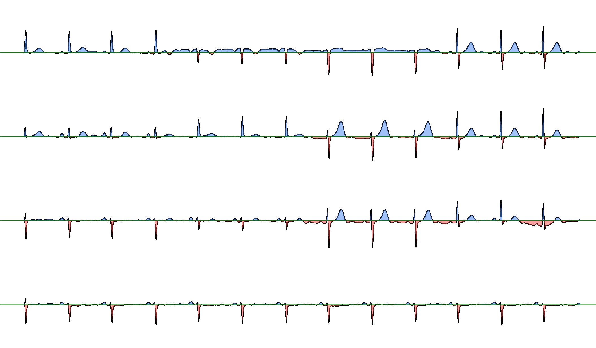

# ECG Image Classifier

A .NET 9 Web API that takes a photo or scan of a 12-lead ECG printout, cleans it with computer vision, turns it into a 160-number feature vector and classifies it with an ML.NET LightGBM model into one of 4 classes: **Normal**, **Myocardial Infarction**, **Abnormal Heartbeat**, **History of MI**.

Built as my master's thesis at Lviv Polytechnic National University (supervisor: Roman Melnyk), then reworked: runs on Linux, honest evaluation, JWT authentication with per-user analysis history in SQLite, unit + integration tests, Docker image.

> ⚠️ This is a learning project, **not a medical device**. Do not use it for diagnosis.

## How it works

1. **Crop** the working area of the printout.
2. **Remove the grid** and isolate the signal, paste it on a white background.
3. **Remove artifacts**: calibration pulse, gain lines, text.
4. **Reconnect** broken signal lines.
5. **Split** the image into 4 horizontal strips.
6. **Extract features**: for each strip find the baseline, split the strip into 20 fragments and measure the area above and below the baseline → 40 features per strip, **160** in total.
7. **Classify** the vector with a LightGBM model (ML.NET).
8. **Save** the result to SQLite (linked to the user) and return a PNG visualization (baselines + areas) with the diagnosis in a response header.



## Tech stack

| Area             | Tools                                                  |
| ---------------- | ------------------------------------------------------ |
| API              | ASP.NET Core 9 Web API, Swagger                        |
| Auth             | JWT Bearer (HS256), `PasswordHasher<T>`                |
| Computer vision  | OpenCvSharp 4.13, SixLabors.ImageSharp                 |
| Machine learning | ML.NET 4 (LightGBM), `PredictionEnginePool`            |
| Database         | EF Core 9 + SQLite, migrations                         |
| Tests            | xUnit, `WebApplicationFactory` (integration tests)     |
| Container        | Docker / Podman, multi-stage build                     |
| Charts           | ScottPlot (learning curves)                            |
| Platform         | .NET 9, Linux (tested on Fedora)                       |

## Project structure

```
ECG_API.sln
├── ECG_API/            # Web API + the whole image-processing pipeline
│   ├── Controllers/    # auth, analyze, history, account endpoints
│   ├── Core/           # service interfaces, models, ML schema
│   └── Infrastructure/ # OpenCV / ML.NET / EF Core / JWT / storage implementations
├── ECG_API.Tests/      # xUnit: unit tests + API integration tests
├── EcgDataGenerator/   # console app: image dataset → features CSV (reuses ECG_API services)
├── EcgModelTrainer/    # console app: CSV → cross-validation → EcgClassifier.zip
└── Dockerfile          # API image
```

The generator calls the same pipeline as the API (shared DI registration `AddEcgProcessing()`), so training features and runtime features are computed identically.

## Getting started (Linux)

The trained model and the dataset are not in the repo (dataset is 589 MB), so the first run takes 3 steps: get data → generate features → train.

**1. Prerequisites:** .NET SDK 9.0.1xx (`global.json` pins `9.0.100` with patch roll-forward).

**2. Clone and download the dataset**

```bash
git clone https://github.com/Denelon99/ECG_API.git
cd ECG_API
```

Download [ECG Images dataset of Cardiac Patients](https://doi.org/10.17632/gwbz3fsgp8.2) (Mendeley Data) and put its 4 class folders into `data/dataset/`:

```
data/dataset/
├── ECG Images of Myocardial Infarction Patients (240x12=2880)/
├── ECG Images of Patient that have abnormal heartbeat (233x12=2796)/
├── ECG Images of Patient that have History of MI (172x12=2064)/
└── Normal Person ECG Images (284x12=3408)/
```

`data/` is gitignored. To keep the data somewhere else, create `appsettings.Development.json` next to `appsettings.json` in `EcgDataGenerator/` and `EcgModelTrainer/` with your own absolute paths — it overrides the defaults and is gitignored.

**3. Generate features and train the model** (run from the repo root)

```bash
dotnet run --project EcgDataGenerator -c Release   # → data/features/dataset_combined.csv (~8 min)
dotnet run --project EcgModelTrainer -c Release    # → data/models/EcgClassifier.zip
cp data/models/EcgClassifier.zip ECG_API/Core/MLModels/
```

**4. Set the JWT signing key**

The key is a secret, so it is not in `appsettings.json`. For local development store it in [user-secrets](https://learn.microsoft.com/aspnet/core/security/app-secrets) (kept outside the repo, loaded only in the `Development` environment):

```bash
dotnet user-secrets set "Jwt:Key" "$(openssl rand -base64 48)" --project ECG_API
```

The API refuses to start without a key.

**5. Run the API**

```bash
dotnet run --project ECG_API --launch-profile http
```

Swagger UI: http://localhost:5209/swagger (log in, then use the **Authorize** button with the token). The SQLite database (`ECG_API/ecg.db`) is created and migrated automatically on startup.

**6. Run the tests**

```bash
dotnet test ECG_API.sln
```

Unit tests cover JWT creation, user-id extraction from claims and the feature calculator. Integration tests start the real API in memory (`WebApplicationFactory`) with a temporary SQLite file and a test key, so they need neither the dataset nor user-secrets.

## Run with Docker

Build the image (works with `docker` too — replace `podman`):

```bash
podman build -t ecg-api .
```

Train the model first (steps 2–3), then run:

```bash
podman run -d --name ecg -p 5300:8080 \
  -e Jwt__Key="$(openssl rand -base64 48)" \
  -v ecg-db:/app/db \
  -v ecg-images:/app/ProcessedImages \
  -v ./ECG_API/Core/MLModels/EcgClassifier.zip:/app/Core/MLModels/EcgClassifier.zip:ro,z \
  ecg-api
```

- The model is **mounted** read-only instead of being built into the image (training needs the 589 MB dataset).
- The database and result images live in **named volumes**, so they survive container re-creation.
- `Jwt__Key` is an environment variable (`__` = `:` in .NET config). A new random key on each run invalidates old tokens — pass a fixed key to keep them.
- `:z` relabels the file for SELinux (Fedora); it is harmless elsewhere.
- The container runs as a non-root user, in the `Production` environment, so Swagger UI is off — use `curl` on http://localhost:5300.

## API usage

Examples use `http://localhost:5209` (local run). All `/api/analysis/*` and `/api/account` endpoints require a JWT in the `Authorization: Bearer <token>` header.

**Register and log in**

```bash
curl -s -H "Content-Type: application/json" \
  -d '{"email":"a@test.com","password":"Passw0rd123"}' \
  http://localhost:5209/api/auth/register          # 201 Created, 409 if the email exists

TOKEN=$(curl -s -H "Content-Type: application/json" \
  -d '{"email":"a@test.com","password":"Passw0rd123"}' \
  http://localhost:5209/api/auth/login | jq -r .token)   # 401 on wrong email or password
```

The password must be at least 8 characters. The token is valid for 60 minutes.

**Analyze an image** — `POST /api/analysis/analyze`, `multipart/form-data`, field `ImageFile` (JPEG or PNG; other formats → 400):

```bash
curl -s -D - -o result.png \
  -H "Authorization: Bearer $TOKEN" \
  -F "ImageFile=@data/dataset/Normal Person ECG Images (284x12=3408)/Normal(1).jpg" \
  http://localhost:5209/api/analysis/analyze
```

The body is the PNG visualization; the diagnosis is in the headers:

```
X-ECG-Predicted-Diagnosis: Normal
X-ECG-Feature-Count: 160
```

**History** — `GET /api/analysis/history`, only the current user's analyses, newest first:

```bash
curl -s -H "Authorization: Bearer $TOKEN" http://localhost:5209/api/analysis/history
```

```json
[{"id":1,"createdAtUtc":"2026-10-12T09:58:49.0437721","originalFileName":"PMI(64).jpg","predictedDiagnosis":"HistoryOfMI","confidence":0.9935852,"resultImageFileName":"180a125037cb4d448c04970b9be7480a_result.png","userId":1}]
```

**Delete account** — `DELETE /api/account` removes the user, all their analyses and all their images → 204:

```bash
curl -s -X DELETE -H "Authorization: Bearer $TOKEN" http://localhost:5209/api/account
```

## Security

I tested the API myself against common JWT and access-control attacks; all of them are rejected:

| Check | Result |
|---|---|
| No token / tampered signature / `alg: none` / expired token | 401 |
| User A reads user B's history (IDOR) | not possible — the user id comes from the token, not from the request |
| User enumeration via login | identical 401 for unknown email and wrong password |
| Guessing image file names | random GUID names in per-user folders |
| Error details | 500 responses don't expose exception messages |

Design choices: passwords are hashed with ASP.NET Core's `PasswordHasher` (PBKDF2); only HS256 is accepted; clock skew is 30 s instead of the default 5 min; the signing key is never in git.

Known limitations / accepted risks:

- **ImageSharp 3.1.11 has known advisories.** The fixes exist only in ImageSharp 4.x, which requires a commercial license key at build time (Release builds fail without one). Mitigation: uploads are decoded with **JPEG and PNG decoders only**, which makes the TIFF-related issues unreachable. One moderate issue (ICC profile parsing) may still be reachable through JPEG/PNG and is accepted for this learning project.
- **JWTs are stateless:** after `DELETE /api/account` an already issued token stays valid until it expires (it just sees an empty history).
- `createdAtUtc` is returned without the `Z` suffix (SQLite doesn't store `DateTimeKind`), so clients should treat it as UTC.

## Results & limitations

The thesis reported **96% accuracy**. While moving the project to Linux I re-checked the data and found that number was inflated:

- **Duplicates.** The dataset has 928 files but only **491 unique** images (byte-identical copies, checked by hash). Myocardial Infarction: 239 files → 30 unique.
- **Data leakage.** A random train/test split puts copies of the same image into both train and test, so the model is tested on images it has already seen.

Fix: the generator now skips duplicates (SHA-256), and the trainer uses **5-fold cross-validation** with **macro accuracy** (classes are imbalanced after dedupe).

| Run | Data | Evaluation | Micro acc. | Macro acc. |
|---|---|---|---|---|
| Thesis | manually cleaned | 80/20 split | 96% | — |
| Now | 491 unique | 5-fold CV | **74.1% ± 4.4%** | **57.8% ± 4.6%** |

Per-class recall (CV, all folds pooled):

| Class | Recall |
|---|---|
| Abnormal Heartbeat | 208/233 = 89% |
| Normal | 116/142 = 82% |
| History of MI | 36/86 = 42% |
| Myocardial Infarction | 5/30 = 17% |

Limitations:

- **Overfitting:** train accuracy is 100%.
- **Myocardial Infarction is poorly recognized** — only 30 unique images. Class weights were tried and gave no real improvement.
- One dataset, one printout format; not validated on real-world photos.

## Credits

- Dataset: Khan, A. H., Hussain, M. (2021). *ECG Images dataset of Cardiac Patients*, Mendeley Data, V2. DOI: [10.17632/gwbz3fsgp8.2](https://doi.org/10.17632/gwbz3fsgp8.2). License: CC BY 4.0.
- Author: Denys Melnyk ([LinkedIn](https://www.linkedin.com/in/denys-melnyk-9276b032a))
- Thesis supervisor: Roman Melnyk, Lviv Polytechnic National University
